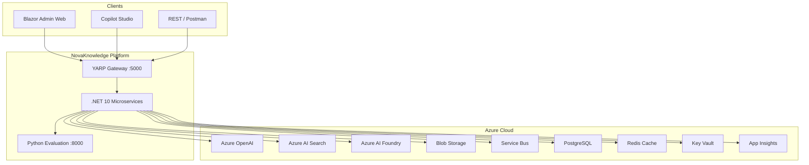
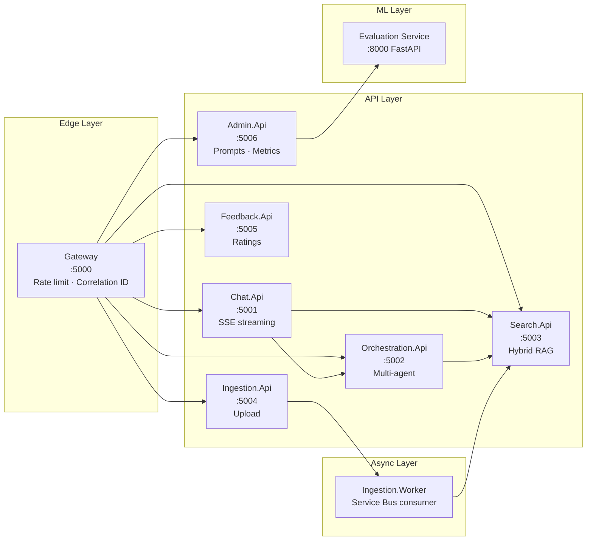
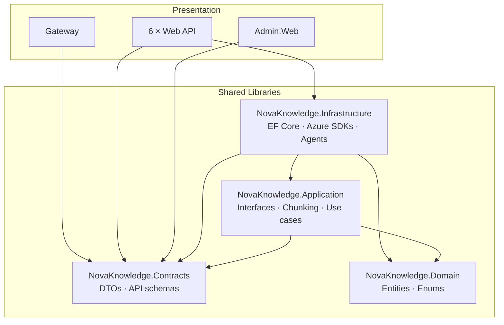
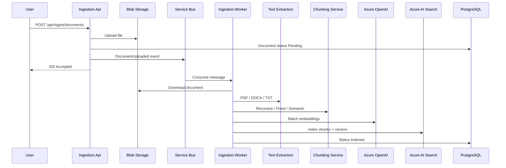
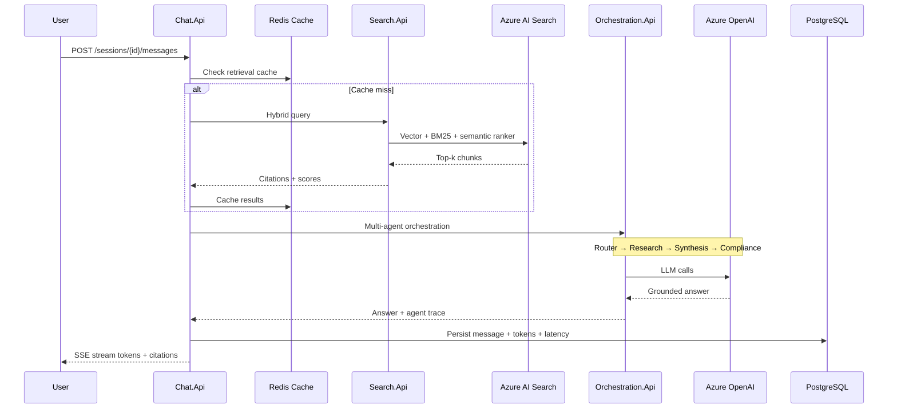
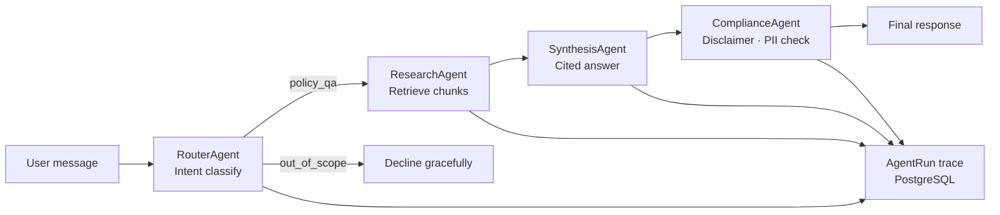
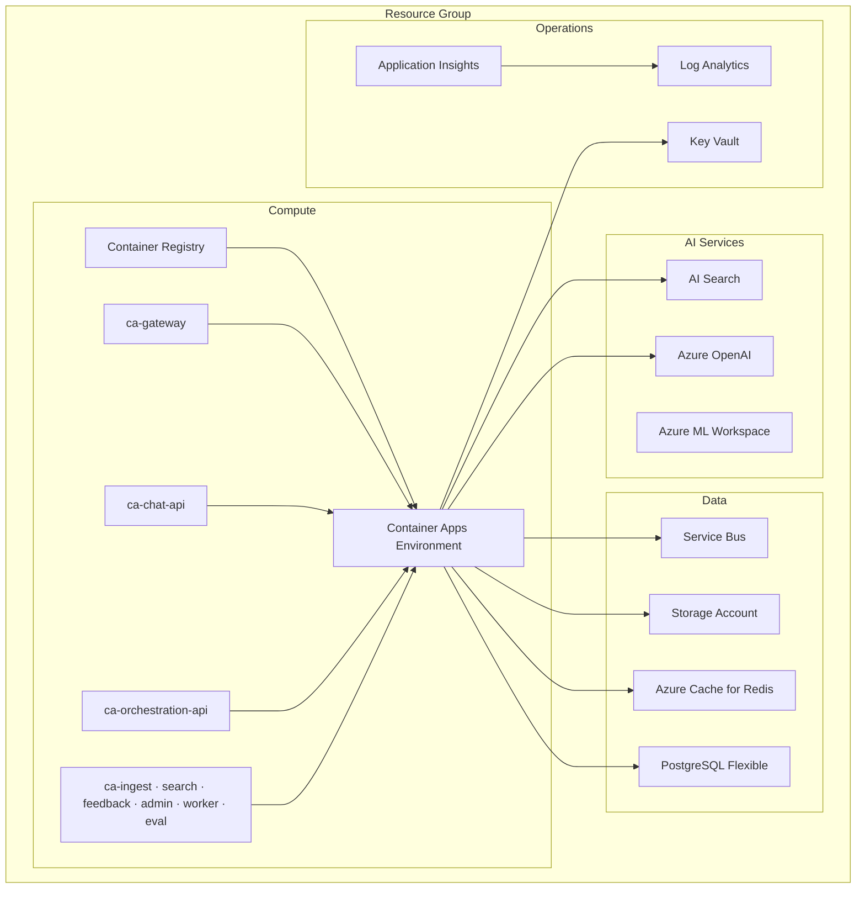
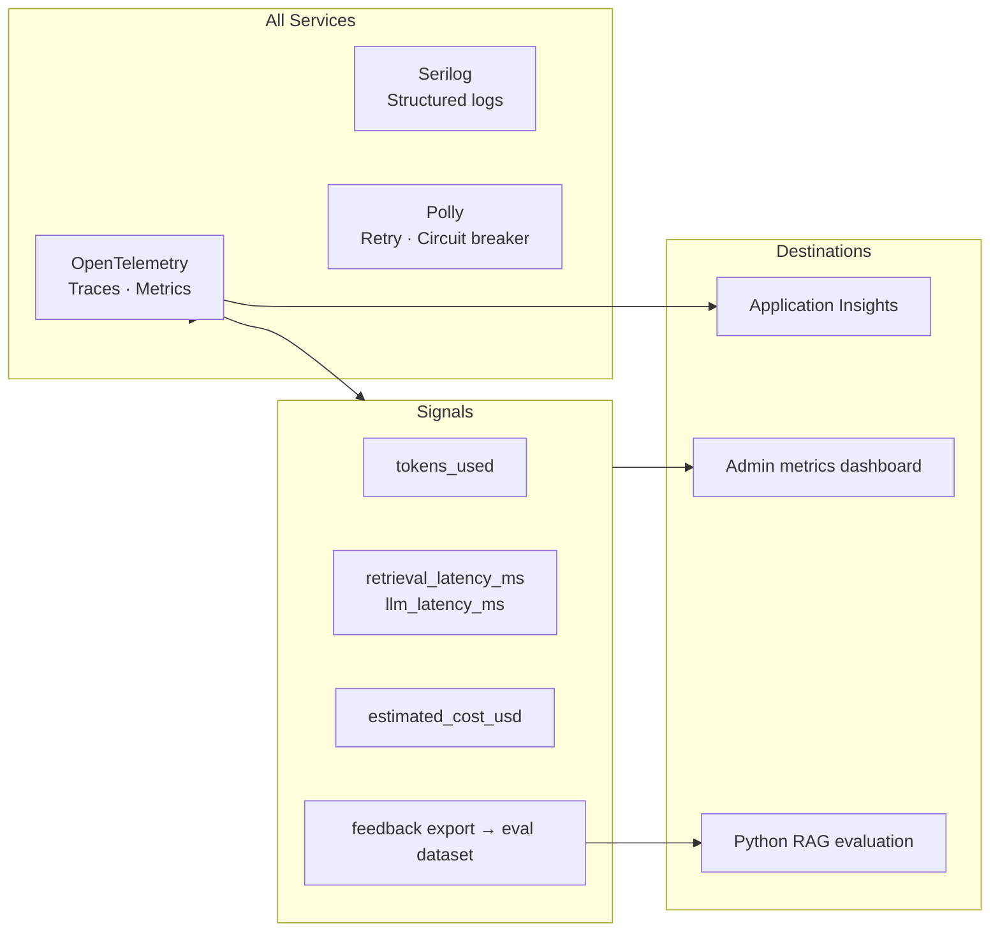
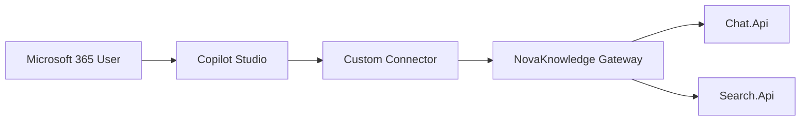

# NovaKnowledge — Architecture Diagrams

Production enterprise knowledge copilot for **Contoso Corp**. All external traffic enters through the YARP gateway; microservices share PostgreSQL, Redis, and Azure AI services.

---

## 1. System context



---

## 2. Microservices topology



| Service | Port | Responsibility |
|---------|------|----------------|
| Gateway | 5000 | YARP reverse proxy, rate limiting, `X-Correlation-Id` |
| Chat.Api | 5001 | Sessions, SSE chat, citation streaming |
| Orchestration.Api | 5002 | Router → Research → Synthesis → Compliance |
| Search.Api | 5003 | Hybrid vector + BM25 + semantic ranker |
| Ingestion.Api | 5004 | Multipart upload, dedup, queue publish |
| Feedback.Api | 5005 | Thumbs up/down, JSONL export |
| Admin.Api | 5006 | Prompts, tenant settings, eval trigger |
| Ingestion.Worker | — | Extract → chunk → embed → index |
| Evaluation Service | 8000 | RAG metrics, chunking benchmarks |

---

## 3. Shared libraries (Clean Architecture)



---

## 4. Document ingestion pipeline (RAG indexing)



**Chunking strategies:** Recursive (default), Fixed (512/128 overlap), Semantic (benchmarked via Python eval service).

---

## 5. Chat and RAG query flow



---

## 6. Multi-agent orchestration



Toggle single-agent vs multi-agent via **Admin → Tenant Settings** (`UseMultiAgent`).

---

## 7. Azure deployment (Bicep)



Deploy with:

```bash
az deployment sub create \
  --location eastus2 \
  --template-file infra/bicep/main.bicep \
  --parameters infra/parameters/dev.bicepparam
```

---

## 8. Observability and AI ops



---

## 9. Copilot Studio integration



> In this demo the connector calls the Gateway without authentication. Adding Entra ID
> OAuth is a documented production extension — see [Copilot Studio Setup](../copilot-studio-setup.md).

See [Copilot Studio Setup](../copilot-studio-setup.md) for connector configuration.

---

## Related docs

- [ADR-001: Hybrid Search](ADR-001-hybrid-search.md)
- [ADR-002: Multi-Agent](ADR-002-multi-agent.md)
- [ADR-003: Chunking](ADR-003-chunking.md)
- [Interview Demo Script](../interview-demo-script.md)
- [Incident Response Runbook](../runbooks/incident-response.md)
